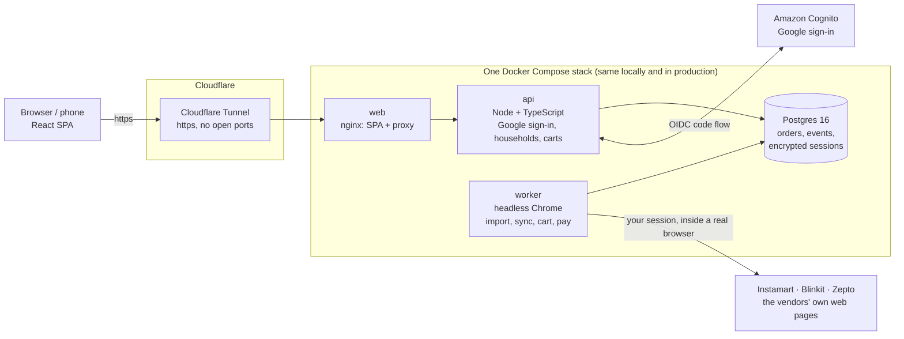

# DhaniyaMirchi

Never run out of the everyday stuff, without ever writing a shopping list.

Dhaniya and mirchi (coriander and green chilli) are the two things every Indian kitchen always needs and always runs out of.

## What it is

A household inventory and replenishment web app. You connect your grocery apps (Swiggy Instamart, Blinkit, Zepto) once. From then on it reads your order history by itself, learns how fast your household goes through each item, estimates what is left at home, and tells you what is about to run out. When you agree, it fills your Instamart cart and can walk the checkout for you.

## Why

Every pantry tracker dies the same way: people stop logging what they buy. DhaniyaMirchi bets on **zero data entry**. Your grocery apps already know what you bought and when, so the app reads that instead of asking.

- **No typing.** Two years of orders import in minutes, and syncs run on their own.
- **Honest predictions.** Consumption rates come from your real buying rhythm. With too little history the answer is "not enough history yet", never a made-up number.
- **The household, not one person.** Several people can each connect their own apps; insights read everyone's orders together.
- **Your money stays your decision.** Paying stops on the vendor's own total and waits for you to agree to that exact number. The CVV and the bank OTP are relayed, never stored.

## How it works



1. **Connect.** You type your phone number and the OTP the grocery app sends you. The worker signs in on its side, in a headless Chrome, and seals the session (AES-256-GCM) in Postgres.
2. **Import.** The worker reads your order history through the vendor's own page. Raw HTTP is blocked by the vendors' bot detection, so it runs inside a real browser. Only line items, quantities and dates are kept; addresses, phone numbers and card digits are dropped on ingest.
3. **Predict.** A pure TypeScript engine (`src/engine/`, no I/O, shared by the browser and the worker) turns orders into consumption rates, confidence and a running-low list. The LLM never does arithmetic: it only turns text into structured data and computed state into a sentence.
4. **Act.** Add to cart fills your real Instamart cart through its own page. Paying drives the vendor's checkout and relays the CVV and the bank's 3-D Secure OTP from your phone.

## Cloudflare Tunnel

The app is reached only through a [Cloudflare Tunnel](https://developers.cloudflare.com/cloudflare-one/connections/connect-networks/). `cloudflared` on the host opens an outbound connection to Cloudflare, and Cloudflare serves the site over https from there:

- **No inbound ports.** The host opens nothing to the internet and its IP is never published. Docker binds every port to `127.0.0.1`.
- **Real https for local development.** `npm run tunnel` exposes the local stack (`localhost:8100`) at a public https address. That is what makes phones work in dev: Cognito only allows http callbacks for `localhost`, and browsers only allow web push and Add to Home Screen on https.
- **Same path in production.** The planned host (an Oracle Cloud Always Free VM) runs the same Compose stack behind the same kind of tunnel, at ₹0 a month.

Tunnel credentials live in `~/.cloudflared` and never in the repo.

## Run it locally

Requires Docker and Node 22.

```bash
cp .env.example .env            # every variable is documented there
docker compose up --build       # postgres, migrate, api, worker, web
# open http://localhost:8100
```

The stack starts with `AUTH_ENABLED=false` (the default), but signing in, and so using the app, needs a Cognito app client with Google: follow [docs/operations/SIGNIN-SETUP.md](docs/operations/SIGNIN-SETUP.md). The engine and its tests need none of that.

Tests:

```bash
npm ci && npm test                                  # engine + frontend
npm --prefix server ci && npm --prefix server test  # api + worker units
npm --prefix server run test:integration            # needs: docker compose up -d postgres
```

## Status

| Vendor | Read order history | Fill cart | Pay |
|---|---|---|---|
| Swiggy Instamart | Yes | Yes | Built and taken to the bank's OTP page; no payment completed yet |
| Blinkit | Yes | No: a Blinkit cart belongs to a device, not an account | No |
| Zepto | Yes | Not yet | No |

Used by two households on a dev deployment. Hosting on the Oracle VM is the next step.

## Stack

React 18 + Vite + TypeScript + Tailwind · Node 22 + TypeScript (api and worker) · Postgres 16 · Playwright attached to Chrome over CDP · Amazon Cognito (Google) · Web Push (VAPID) · Docker Compose · nginx · Cloudflare Tunnel · Vitest

## Repository

| Path | What |
|---|---|
| `src/` | React SPA; `src/engine/` is the pure prediction engine |
| `server/src/api/`, `server/src/auth/` | api and server-side OIDC sign-in |
| `server/src/worker/` | headless browser worker: connect, import, cart, pay |
| `server/db/migrations/` | SQL migrations, applied by the `migrate` service |
| `web/` | nginx image serving the SPA and proxying `/api` and `/auth` |
| `spike/` | Phase 0 experiments that proved each vendor could be read |
| `docs/product/design.md` | the design document |
| `docs/` | progress log, lessons, Compose walkthrough, sign-in setup |

## Responsible use

This is a personal project. It acts only on accounts you sign into yourself, through the vendors' own web pages, at a human pace. It is not affiliated with Swiggy, Blinkit or Zepto, and their terms of use apply to your accounts. Personal details in the test fixtures (names, addresses, phone numbers, account and order IDs) are placeholders.

## Authorship

Designed and built by [Alex Doe](https://github.com/akhiljoe), with [Claude Code](https://claude.com/claude-code) as a pair programmer. The project rules it follows are in [`CLAUDE.md`](CLAUDE.md).

## License

[MIT](LICENSE)
